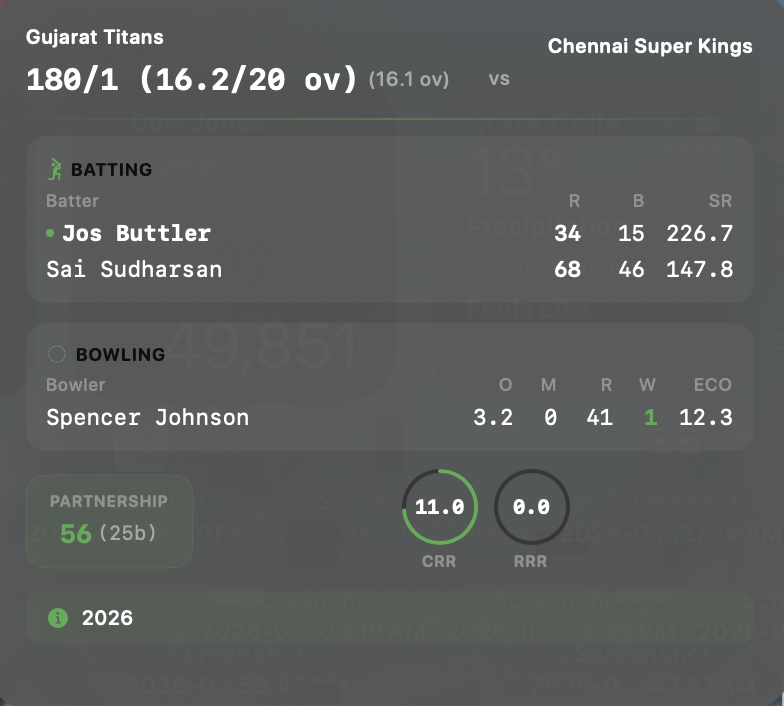

> 1.3 preview restores the physical-notch top anchor and pull-down interaction, shows three activities at once, and adds experimental native Clock controls. See [details and validation](docs/NOTCH-RESTORATION.md).

> Calendar update: today’s collapsed event advances automatically at its end time. Apple Calendar events stay untouched. See [calendar behavior and setup](docs/CALENDAR.md).

# 🏟️ NotchIslandSports

> **1.1 preview:** Battery/lifecycle fixes and split sports, music, and **native Apple Clock observation** are implemented on this branch. No in-app timers were added. Native Clock and system media integration are experimental. [Download/build instructions](docs/BUILDING.md) · [Changes and test checklist](docs/IMPLEMENTATION.md). The root ZIP below is still the older build.

A premium, native macOS background utility that transforms your MacBook Pro/Air screen notch into a highly fluid, responsive live sports tracking dashboard. 

Stream real-time ball-by-ball sports data and score updates natively right under your display bezel.

---

## ✨ Features

* **🏏 Live Multi-Sport Engine:** Production-grade background parsing across 8 sports (Cricket/IPL, Tennis, NFL, College Football, College Basketball, Soccer, Lacrosse,Volleyball, MLB, NBA, F-1,NHL, College Ice Hockey) powered by polling-optimized ESPN API endpoints.
* **🏏 Cricket Mode:** 
•	Collapsed View: A tight, minimalist pill showing team names and the current score line (e.g., 🏏 GT 185/4 • CSK).
•	On Hover: The panel stretches downward into a detailed match scorecard
* **📱 Adaptive Bezel Layouts:** Native geometry inspection. If running on a notched Apple Silicon MacBook Pro, it locks down into an ultra-compact **220pt capsule**. If running on flat-bezel MacBooks (Intel), it dynamically expands into a detailed, untruncated **340pt floating pill**.
* **🔄 Rolling Recency & Auto-Pivoting:** Smart layout hierarchy prioritizes live matches automatically. If no active live frames are running, the app gracefully cycles the last 24 hours of completed games (like yesterday's KKR vs MI clash) or renders visual upcoming match countdown badges.
* **Multi Language Support and other features in cricket scorecard** One can now view the cricket scorecard also in Hindi language. Features also added include animation to show drinks break, end of innings, stumps etc.

---

## 📦 Fast Installation (No Coding Required)
Download the NotchIslandSports.zip file from the file list above.
Extract the file and drag NotchIslandSports.app straight into your Applications folder.
For the updated preview, follow [Download/build instructions](docs/BUILDING.md). Preview builds are ad hoc signed; a Developer ID signed and notarized release is still pending. Follow normal macOS security prompts.

To select match click on the icon in menu bar and select match then hover over the black colored bar and you can choose your matche by clicking it.

## App Previews
Here is how the application renders on screen during live match intervals:

### 1. Collapsed Untruncated View (Intel / Flat Bezel Screens)

### 2. Collapsed Untruncated View (Apple Silicon / With notch)

### 3. Expanded Scorecard Dropdown Panel

## 📄 License & Copyright

This project is licensed under the terms of the MIT License.

Copyright © 2026 Sahil Pardasani. All rights reserved. 

Contributions, bug fixes, and feature requests for new sports divisions are welcome!

